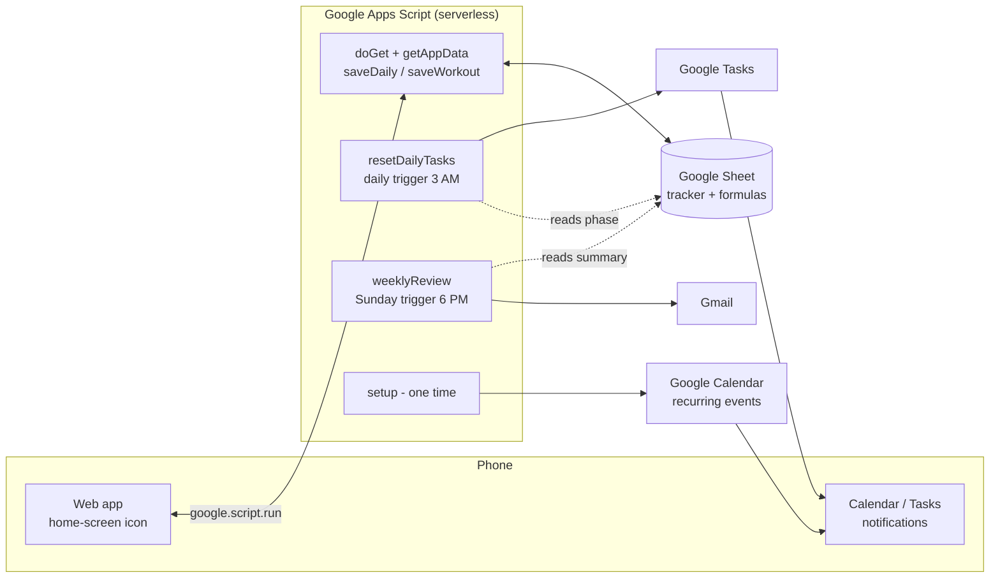

# Health OS

A personal health & fitness "operating system" built entirely on free Google services. It reminds me to eat, drink water, train and sleep. It tracks progress and tells me when to adjust calories. It all runs serverless on Google Apps Script, so nothing depends on my laptop being on.

> Built to solve a real problem: a reactive support job plus a second physical job made it easy to forget meals, hydration and recovery. The goal was a system that runs itself, with **< 2 minutes of daily admin**.

## Features

- **Timed reminders:** a dedicated Google Calendar with recurring events built around two work schedules. It sends about 5–6 notifications a day, timed to fall between calls.
- **Daily checklist:** a Google Tasks list rebuilt every morning at 3 AM. Workout tasks only appear on training days, and shift tasks drop off automatically when the routine changes phase.
- **Mobile web app** (installable on the iPhone home screen):
  - **Today:** log weight, sleep and energy, plus **food & drinks with automatic calorie / protein / water totals**. Tap from a personal food library and pick a portion (½ / 1 / 1½ / 2×), or add a custom item. Live progress bars, and the checklist ticks itself as targets are reached.
  - **Workout:** today's A or B session, pre-filled with *what I lifted last time* (progressive overload).
  - **Progress:** weekly average weight and a progress bar to goal, weekly change vs a target band, workouts per week, sleep, and the calorie check (charts via Chart.js).
- **Food library & log:** `Foods` and `Food Log` tabs. Daily totals come from `SUMIFS`, and the weekly average calories sit next to the weight trend, so calorie adjustments are based on real intake.
- **Tracker Sheet:** formulas calculate weekly averages, trend status (on track / slow / fast) and a **2-week calorie recommendation** (+150 / hold / −150 kcal).
- **Weekly review email** every Sunday evening.
- **Phase switch:** one cell on the tracker moves the whole system from "two jobs" to "remote only".

## Architecture



| Layer | Technology |
|---|---|
| Backend | Google Apps Script (V8), time-driven triggers, Tasks API advanced service |
| Data | Google Sheets (`AVERAGEIFS` / `SUMIFS` / `COUNTIFS` formulas do the analytics) |
| Frontend | Apps Script `HtmlService` web app, vanilla JS, Chart.js, light/dark mode |
| Reminders | Google Calendar recurring event series with popup reminders |
| Tooling | [`clasp`](https://github.com/google/clasp) for local dev + Git; Node's built-in test runner |

## Design decisions

- **Google-native over local scripts.** Windows Task Scheduler or PowerShell jobs would stop whenever the laptop is off. Apps Script triggers run in Google's cloud for free.
- **The Sheet is the database.** Analytics live in spreadsheet formulas, so the data stays readable and editable by hand. The app and the weekly email just read what the formulas produce.
- **Tasks API has no recurrence.** Instead of fighting it, a daily job deletes and re-creates the checklist. Unfinished items never pile up, which keeps the system guilt-free.
- **Idempotent setup.** `setup()` checks for an existing calendar, task list and a script-property flag before creating anything, so re-running it never duplicates events. Tested by running it twice.
- **Private by default.** The web app is deployed *Execute as: me / Access: only myself*. It needs no API keys and no public endpoint. Personal settings live in a git-ignored `config.js`.
- **Testable core.** Scheduling logic (`buildTaskItems_`, `firstMatchingDay_`) is written as pure functions, so it can be unit-tested in Node without Google services.

### Bug worth noting: time zones
End-to-end testing caught workouts being saved under the *previous day*. The spreadsheet had kept the default time zone from its import, while the script ran on America/New_York. So `new Date(y, m, d)` at local midnight landed on the evening before in the Sheet's zone. Two changes fixed it:
1. `Utilities.parseDate(dateKey, sheetTimeZone, 'yyyy-MM-dd')`: build dates in the Sheet's own zone.
2. A one-time `maintenance()` that aligns the Sheet's time zone with `CONFIG.TZ`.

Lesson: when two systems each have a time zone, pin them to the same one explicitly.

## Repository layout

```
src/                  ← pushed to Apps Script by clasp (rootDir)
  Code.js             automation: setup, daily checklist, weekly email
  WebApp.js           web app backend (doGet, getAppData, saveDaily, saveWorkout)
  Food.js             food library + log, daily totals, auto-ticking checklist
  Index.html          mobile UI (Today / Workout / Progress)
  appsscript.json     manifest: time zone, OAuth scopes, Tasks advanced service
  config.js           YOUR settings — git-ignored
config.example.js     template for src/config.js
tests/                Node unit tests (no dependencies)
.clasp.example.json   template for .clasp.json (links the folder to a script project)
```

## Run it yourself

1. **Make the tracker Sheet** with tabs `Start Here`, `Daily Log`, `Weekly Summary` and `Workout Log`. The column layouts are in [`WebApp.js`](src/WebApp.js) (`getAppData`) and [`Code.js`](src/Code.js) (`weeklyReview`).
2. **Install the tools** (needs Node.js 20+):
   ```bash
   npm install
   npx clasp login          # opens a browser for Google sign-in
   ```
   Then turn on the **Google Apps Script API** at <https://script.google.com/home/usersettings> (one-time).
3. **Create the project and configure it:**
   ```bash
   npx clasp create --type standalone --title "Health OS" --rootDir src
   cp config.example.js src/config.js      # then edit: Sheet ID, schedule, dates
   npm test                                # sanity-check the logic and example config
   npx clasp push
   ```
4. In the Apps Script editor: add the **Tasks API** service (it's declared in the manifest, so this is usually automatic), run **`setup`** and approve the permission screen, then run **`setupFood`** once to create the food tabs.
5. **Deploy the web app:** Deploy → New deployment → Web app → *Execute as: Me*, *Who has access: Only myself*. Open the URL on your phone → Share → **Add to Home Screen**.

## Day-to-day dev workflow (clasp)

```bash
npx clasp pull        # get the latest code from Apps Script (includes your config.js)
# …edit in VS Code…
npm test
npx clasp push        # upload to Apps Script; triggers use the new code immediately
git add -A && git commit -m "…" && git push
```
The web app serves a **versioned** deployment. After pushing UI or backend changes, publish them with
`npx clasp deploy -i <DEPLOYMENT_ID> -d "what changed"` (or Deploy → Manage deployments → Edit → New version). The URL stays the same.

## Security & privacy

- No secrets in code. Google handles auth through OAuth consent, and the refresh token is stored by Google, not in this repo.
- `src/config.js` (Sheet ID and schedule) and `.clasp.json` (script ID) are git-ignored.
- The web app is only reachable by the owner's Google account.
- Revoke at any time: delete the triggers in the project, then remove access at <https://myaccount.google.com/permissions>.

## Limitations

- Google Tasks can't take timed reminders through the API, so timed nudges come from Calendar events.
- Apps Script web apps show a small "created by a Google Apps Script user" banner and load in 1–2 s.
- Free-tier quotas (about 100 emails/day, 90 min of triggers/day) are far above what this uses.

## License

MIT
